# TheSushant Communication API
[](https://incidents.betterstack.com/?utm_source=status_badge)
**A production-ready, multi-tenant email delivery infrastructure.**

[Live Platform](https://communication.thesushant.in) · [Documentation](https://docs.thesushant.cloud/docs/Communication/Introduction/) · [API Reference](https://docs.thesushant.cloud/docs/category/api-reference)

*Note: The core backend infrastructure is proprietary and closed-source. This repository serves as a technical case study, architectural overview, and documentation showcase.*

---

## What is this?
A high-throughput email API designed for developers. Built to handle transactional and bulk email with enterprise-grade deliverability, sandboxing, and analytics. 

Instead of just sending emails, it solves the hardest parts of email infrastructure: **domain reputation, bounce tracking, and API reliability.**

## Developer Experience
Integration takes minutes. We support a sandbox mode (`sk_test_`) that returns real API responses without actually sending SMTP traffic, allowing developers to build safely.

```bash
curl -X POST https://communication.thesushant.in/v3/email/send \
  -H "X-API-Key: sk_test_..." \
  -H "Content-Type: application/json" \
  -d '{
    "to": "user@example.com",
    "subject": "Welcome aboard",
    "body": "<p>Your account is ready.</p>",
    "priority": "transactional"
  }'
```

**Response:**
```json
{
  "success": true,
  "tracking_id": "a4f3...",
  "status": "mock",
  "queued": false,
  "note": "Test key — no email was delivered."
}
```

---

## Hard Problems Solved (Engineering Depth)

### 1. Deliverability & Auth (DKIM/SPF/DMARC)
Email providers (Gmail, Outlook) block generic SMTP. We built a system that generates 2048-bit RSA keypairs per customer domain, guides the user through DNS setup, and automatically verifies SPF/DKIM/DMARC propagation via DNS TXT lookups. Every email is cryptographically signed.

### 2. Bounce Processing (VERP)
Handling bounces is notoriously messy. We implemented **VERP (Variable Envelope Return Path)**. Every single email gets a unique envelope sender (`bounces+tracking_id@thesushant.in`). When a bounce occurs, our IMAP parser catches it, extracts the exact tracking ID, classifies it (hard/soft/complaint), and updates the suppression list automatically.

### 3. Reliability & Rate Limiting
- **Priority Queues:** Emails are tiered (Urgent, Transactional, Normal, Bulk) and processed by cron workers with exponential backoff on failure.
- **Reputation Protection:** Enforced hourly and daily per-recipient-domain throttling.
- **Idempotency:** Custom `X-Idempotency-Key` implementation to prevent duplicate sends on network retries.

---

## Documentation
The platform includes full Docusaurus documentation covering API endpoints, webhook payloads, SDK integration, and error codes.

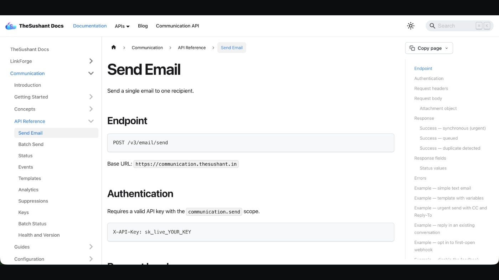

---

## Platform Showcase

### Dashboard & Analytics
The user-facing portal for monitoring quotas, sends, and engagement.
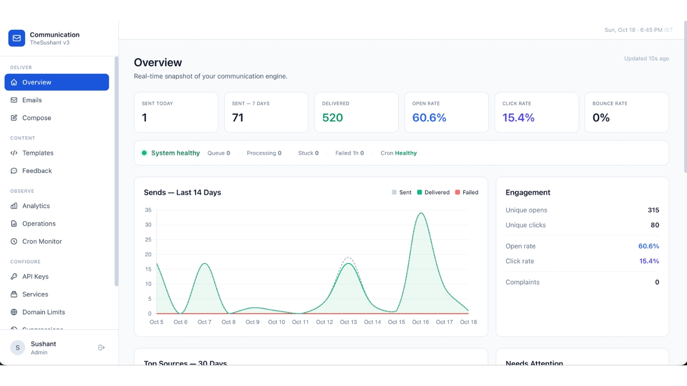
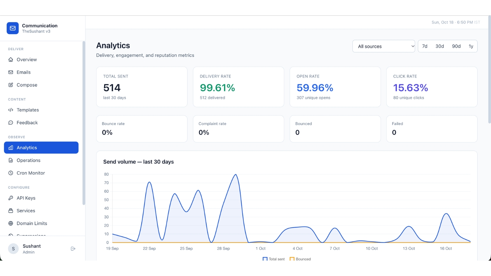

### Email Lifecycle & API Logs
Detailed tracking of every message, including delivery status, open events, and API key management.
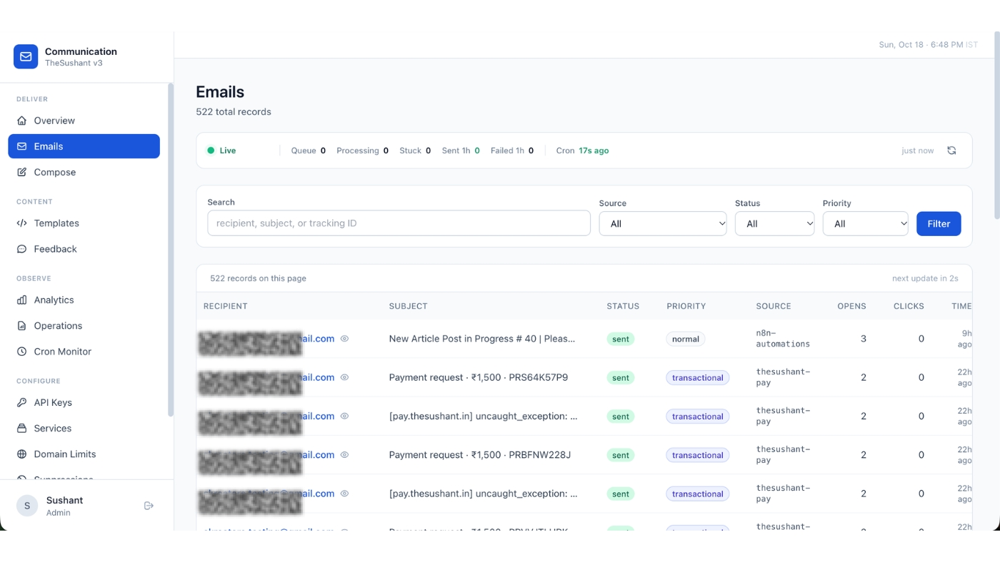
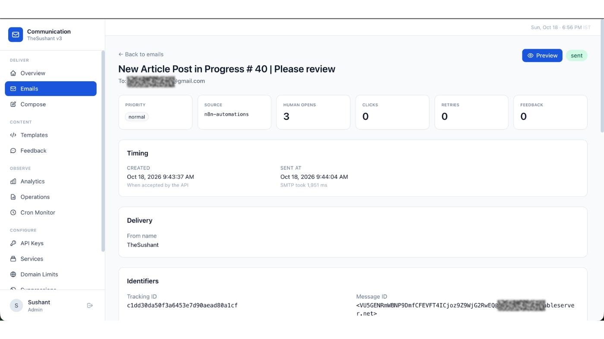
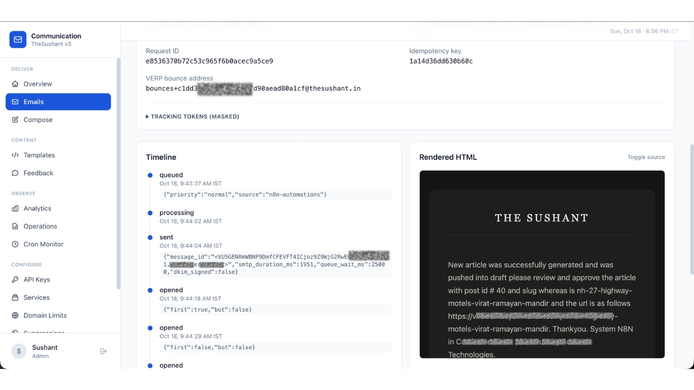
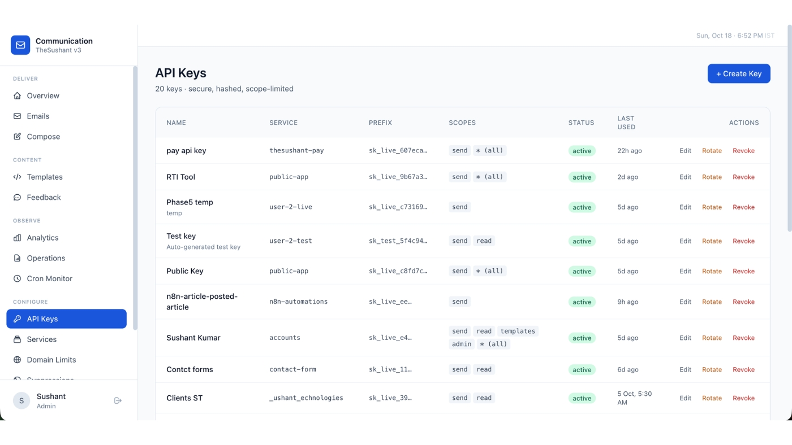

### ⚙️ Infrastructure & Operations
Internal dashboards for managing queue health, cron workers, webhooks, and suppression lists.
<details>
  <summary><b>Click to expand Internal Ops Screenshots</b></summary>
  <br>
  
  **Cron Worker Health**
  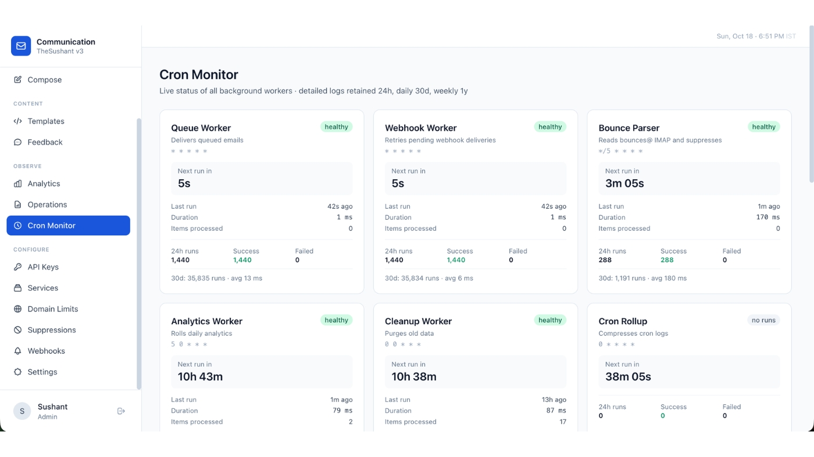
  
  **Operations & Queue**
  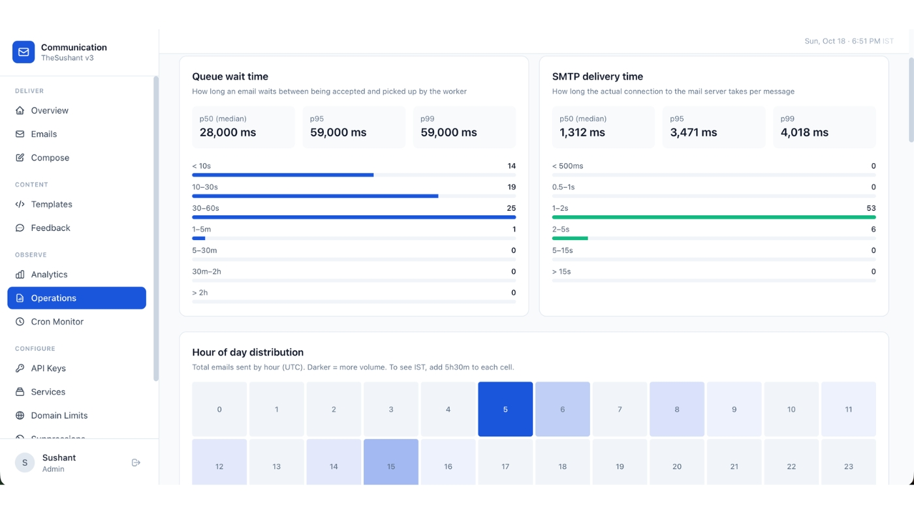
  
  **Webhooks & Retries**
  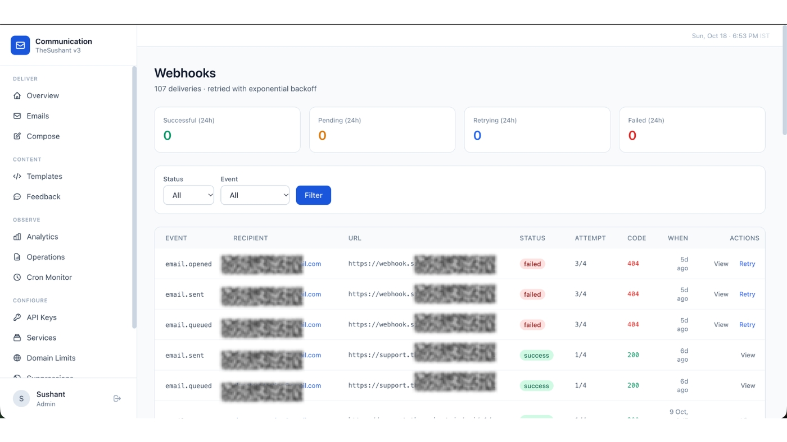
  
  **Suppressions (Bounces/Complaints)**
  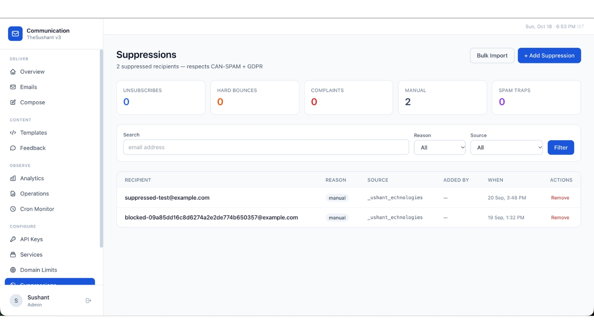
  
  **Feedback Funnel**
  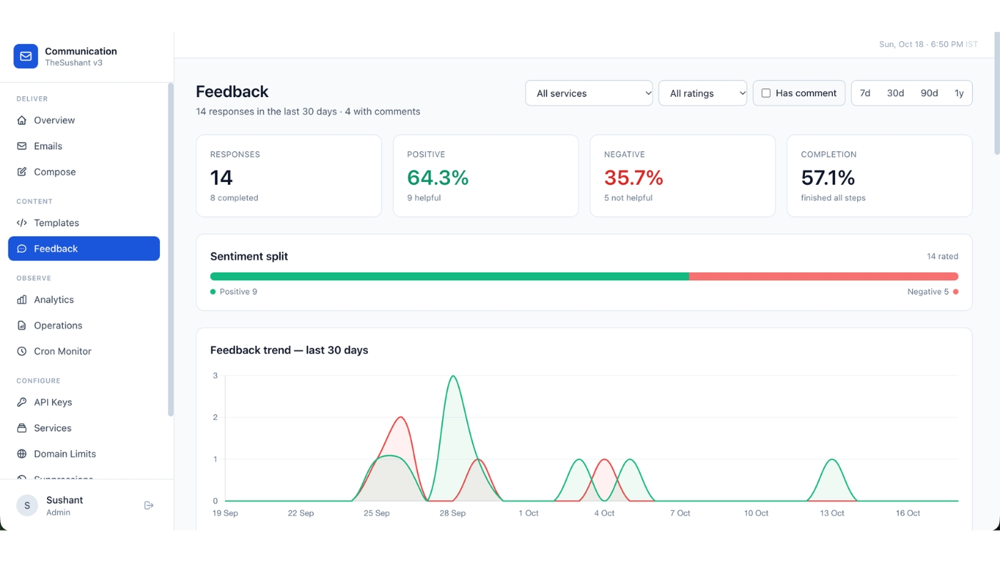
  
  **Service Management**
  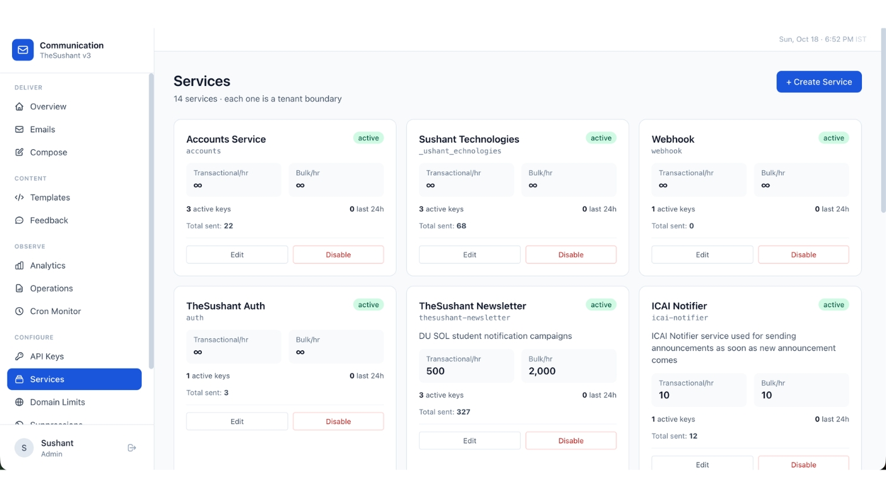
</details>

---
**Tech Stack:** PHP 8.4 · MariaDB 11.4 · PHPMailer · Cloudflare (DNS & Turnstile) · Docusaurus
